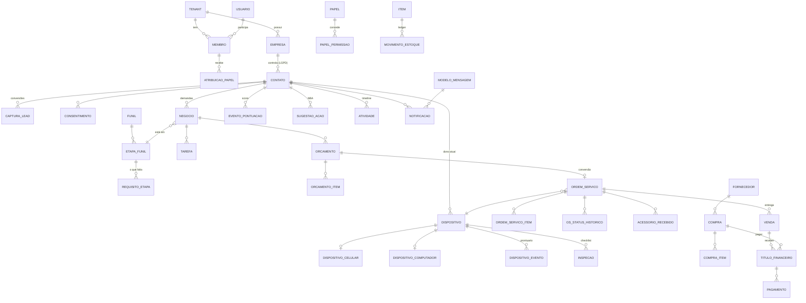

# ebisuCRM — Análise, escopo v1 e modelo de dados de referência (v0.1)

> CRM/prospecção + bancada de OS + estoque simplificado para assistências técnicas
> de celulares, notebooks e PCs. Multi-tenant, multi-empresa, RBAC.
> O modelo de dados completo está em [`schema.prisma`](./schema.prisma) (validado com Prisma 6).
> O Ogun é **referência**; estes arquivos vão para o repositório novo do ebisuCRM.

---

## 1. Decisões principais (resumo)

| # | Decisão | Por quê |
|---|---------|---------|
| 1 | **Lead e Cliente são a mesma entidade (`Contato`)**, com `ciclo_vida` (LEAD → LEAD_QUALIFICADO → OPORTUNIDADE → CLIENTE → RECORRENTE / INATIVO) | Modelo HubSpot/RD Station. Evita a "conversão com cópia" do Salesforce, que duplica dados e quebra o histórico. |
| 2 | **Demanda = `Negocio`** (deal) num **funil com etapas** e **requisitos por etapa** | Um contato pode ter várias demandas (celular hoje, notebook amanhã). Requisitos = "o que falta para avançar" (Zoho Blueprint). |
| 3 | **Conversão = orçamento aprovado → OS**; o negócio vai para GANHO e o contato para CLIENTE | Definição dada no briefing. |
| 4 | **Score em 2 dimensões (Fit × Engajamento)** → `temperatura` + `quadrante` | Responde diretamente "cultivar agora / prospectar mais / pronto para comprar / trabalhar depois". |
| 5 | **Next Best Action por regras explicáveis** (não ML na v1) | Volume de dados pequeno no início; regras são auditáveis e configuráveis por empresa. |
| 6 | **Dispositivo = tabela base + extensões 1:1** (`celular`, `computador`) + **prontuário** append-only (`dispositivo_evento`) | Generaliza Celular/Notebook do Ogun, inclui PC/tablet e guarda o histórico do aparelho mesmo se ele trocar de dono. |
| 7 | **Checklist configurável** (`checklist_modelo` → `inspecao`) de ENTRADA e SAÍDA | No Ogun os campos de checklist estão duplicados em Orçamento e OS; aqui vira dado, e o modelo padrão replica os campos do Ogun. |
| 8 | **Estoque = ledger imutável com custo médio móvel**; usuário só vê "Comprei / Usei-Vendi / Ajustei / Devolvi" | Contabilmente correto (CPC 16) e simples na tela. Mapeia 1:1 para ERPNext no futuro. |
| 9 | **Notificações via Outbox** na mesma transação da mudança de status, canal preferido + fallback | Nunca perde aviso; retry, status de entrega e LGPD centralizados. |
| 10 | **Tenant → Empresa (CNPJ)**; dados de cliente/estoque com escopo **por empresa**; RLS no Postgres | O controlador LGPD é o CNPJ; compartilhar clientes entre CNPJs exige base legal. RLS impede vazamento entre tenants mesmo com bug na API. |

---

## 2. Benchmark — o que aproveitamos de cada sistema

### 2.1 CRMs de mercado

| Sistema | Conceito-chave | Como entra no ebisuCRM |
|---|---|---|
| **Salesforce** | Lead → (convert) → Account/Contact/Opportunity; Opportunity Stages com probabilidade; Lead Status | Etapas com `probabilidade` para forecast. **Não** copiamos a conversão com cópia. |
| **HubSpot** | Contato único com *Lifecycle Stage* (Subscriber → Lead → MQL → SQL → Opportunity → Customer → Evangelist); *Lead Status*; score de Fit + Engagement com decaimento | `Contato.ciclo_vida`; `RegraPontuacao` com `dimensao` e `meia_vida_dias`. |
| **RD Station** (BR) | Lead Scoring **Perfil (A–D) × Interesse**; funil Visitante → Lead → Lead Qualificado → Oportunidade → Cliente; UTM e conversões por formulário | Quadrante Fit × Engajamento; `CapturaLead` guarda cada conversão bruta com UTMs. |
| **Pipedrive** | *Activity-based selling*: todo negócio precisa de uma próxima atividade; *rotting* (negócio parado fica vermelho) | `EtapaFunil.sla_horas`; NBA garante que nenhum negócio aberto fique sem próxima ação. |
| **Zoho CRM** | *Blueprint* (etapas com transições e campos obrigatórios); Zia sugere "next best action" | `RequisitoEtapa` (CAMPO / TAREFA / REGRA) bloqueia avanço e gera tarefas; `SugestaoAcao`. |
| **Kommo / Chatwoot** | CRM centrado em WhatsApp; conversas viram timeline | `Atividade` como timeline única; inbound de WhatsApp vira atividade + evento de engajamento. |
| **Frameworks BANT / CHAMP** | Qualificação por Budget, Authority, Need, Timing | Adaptado ao varejo de reparo: **Necessidade** (dispositivo + problema), **Urgência**, **Canal/consentimento**, **Faixa de valor**. |

### 2.2 Softwares de assistência técnica

| Sistema | Conceito-chave | Como entra |
|---|---|---|
| **RepairShopr / RepairDesk / Orderry** | Ticket com status customizáveis, checklist pré/pós reparo, SMS automático por status, peças reservadas por ticket, histórico por IMEI/serial | `StatusOS`, `Inspecao` (ENTRADA/SAIDA), `ConfigNotificacaoEvento`, `ReservaEstoque`, busca por IMEI/serial. |
| **mHelpDesk / GestãoClick / Bling (BR)** | Orçamento com aprovação por link, sinal/adiantamento, garantia por OS | `Orcamento.token_publico`, `TituloFinanceiro` ligado à OS (sinal), `garantia_ate` e OS de retorno (`os_origem_id`). |
| **ERPNext** | Item, Supplier, Purchase Receipt/Invoice, Stock Ledger Entry (custo médio), Sales Invoice, Payment Entry | Mesma lógica, telas simplificadas; `IntegracaoRef` para sincronizar depois. |

---

## 3. Prospecção (CRM)

### 3.1 Funil padrão e requisitos ("o que falta")

| Ordem | Etapa | Entra quando… | Requisitos para avançar (geram tarefas) | Prob. |
|---|---|---|---|---|
| 1 | **Novo contato** | Só nome + telefone/e-mail (form, WhatsApp, balcão, importação) | Nome; telefone **ou** e-mail; origem | 5% |
| 2 | **Qualificação** | Primeiro contato feito | Canal preferido + consentimento; tipo/marca/modelo do dispositivo; problema/interesse; urgência | 20% |
| 3 | **Diagnóstico / Orçamento** | Necessidade clara | Dispositivo cadastrado **ou** orçamento remoto; tarefa "elaborar orçamento" | 40% |
| 4 | **Orçamento enviado** | `Orcamento.status = ENVIADO` | Follow-up registrado | 60% |
| 5 | **Negociação** | Cliente respondeu / pediu ajuste | Objeção registrada; revisão de orçamento se necessário | 75% |
| — | **Ganho** | Orçamento APROVADO → OS criada | — | 100% |
| — | **Perdido** | Motivo de perda obrigatório | — | 0% |
| — | **Nutrição** | Sem timing agora (ex.: "volto mês que vem") | Data de reativação | — |

`completude_perfil` = requisitos atendidos ÷ requisitos até a próxima etapa. `campos_faltantes` alimenta o card do lead ("Falta: modelo do aparelho, canal preferido").

### 3.2 Lead scoring, temperatura e quadrante

**Fit (0–50) — "esse lead é bom para nós?"** (exemplos de regras padrão)

| Regra | Pontos |
|---|---|
| Tem WhatsApp válido | +8 |
| Tem e-mail | +3 |
| Dispositivo identificado (tipo + modelo) | +10 |
| Problema/interesse descrito | +10 |
| Modelo do aparelho tem peças compatíveis em estoque | +5 |
| Consentimento transacional registrado | +5 |
| Já foi cliente | +7 |
| Fora da área de atendimento | −10 |

**Engajamento (0–50, com decaimento por meia-vida)** — "ele está interessado agora?"

| Evento | Pontos | Meia-vida |
|---|---|---|
| Preencheu formulário | +10 | 14 d |
| Iniciou orçamento online | +15 | 7 d |
| Abandonou orçamento online | +10 | 7 d |
| Respondeu WhatsApp/e-mail | +10 | 7 d |
| Abriu link do orçamento | +10 | 3 d |
| Visitou a loja | +15 | 14 d |
| Sem resposta após 3 tentativas | −10 | — |

**Saídas**

- `temperatura`: score_total ≥ 70 **QUENTE**, 40–69 **MORNO**, < 40 **FRIO**.
- `quadrante` (corte padrão 25/25, configurável):

| | Engajamento alto | Engajamento baixo |
|---|---|---|
| **Fit alto** | 🟢 **PRONTO_PARA_COMPRAR** — fechar já | 🟡 **CULTIVAR** — nutrir agora (conteúdo, lembrete, oferta) |
| **Fit baixo** | 🟠 **PROSPECTAR** — engajado mas perfil incompleto: completar dados | ⚪ **TRABALHAR_DEPOIS** — baixa prioridade |

Cada ponto fica em `evento_pontuacao` → o usuário vê **por que** o lead está quente.

### 3.3 Next Best Action (regras padrão)

| Prioridade | Condição | Ação sugerida |
|---|---|---|
| 1 | Orçamento expira em ≤ 24h e não decidido | FOLLOW_UP_ORCAMENTO (canal preferido) |
| 2 | Orçamento ENVIADO/VISUALIZADO há > 48h sem resposta | FOLLOW_UP_ORCAMENTO |
| 3 | Quadrante PRONTO_PARA_COMPRAR sem orçamento | ELABORAR_ORCAMENTO / AGENDAR_ENTRADA |
| 4 | Lead novo há > 15 min sem 1º contato (speed-to-lead) | LIGAR / ENVIAR_WHATSAPP |
| 5 | Quadrante PROSPECTAR | COMPLETAR_PERFIL / IDENTIFICAR_DISPOSITIVO |
| 6 | Negócio parado acima do `sla_horas` da etapa | LIGAR |
| 7 | OS ENTREGUE há 7 dias | PEDIR_AVALIACAO |
| 8 | Garantia vence em 15 dias / bateria trocada há 12 meses | OFERECER_UPSELL |
| 9 | Cliente sem interação há 6 meses | REATIVAR_CLIENTE |

A fila "Minhas próximas ações" ordena `sugestao_acao` por `peso` (prioridade × score do lead). Aceitar → cria `Tarefa`; descartar → aprende nada na v1 (só registra).

### 3.4 Relatórios / insights v1

Funil (conversão por etapa e tempo médio por etapa), leads por origem/UTM, distribuição por quadrante e temperatura, taxa de aprovação de orçamento, motivo de perda, ticket médio, tempo de resposta ao lead (speed-to-lead), leads parados (rotting), receita e margem por período/técnico/categoria, TAT (tempo de bancada) por status e por técnico, reparos por modelo de dispositivo, estoque abaixo do mínimo.

---

## 4. Conversão e Bancada

### 4.1 Máquina de estados — Orçamento

```
RASCUNHO → ENVIADO → VISUALIZADO → APROVADO | APROVADO_PARCIAL → CONVERTIDO (cria OS)
                              ↘ REPROVADO   ↘ EXPIRADO (job diário)   ↘ CANCELADO
Revisão: cria nova versão (orcamento_pai_id) e a anterior vira CANCELADO.
```

- Aprovação por **link público** (`token_publico`), WhatsApp, presencial etc. (`decidido_via`).
- Itens `opcional` permitem aprovação parcial (só os itens `aprovado = true` vão para a OS).
- Ogun: `make_ordem_de_servico` (get_mapped_doc) → aqui `POST /orcamentos/:id/converter`.

### 4.2 Máquina de estados — OS (Bancada)

```
ABERTA → EM_DIAGNOSTICO → AGUARDANDO_APROVACAO → AGUARDANDO_PECAS → EM_REPARO → EM_TESTES → PRONTA → ENTREGUE
   └───────────── qualquer estado antes de ENTREGUE → CANCELADA | SEM_REPARO
```

| Ogun | ebisuCRM |
|---|---|
| Pendente | ABERTA |
| Confirmada | (aprovada) → AGUARDANDO_PECAS ou EM_REPARO |
| Adquirindo Peças | AGUARDANDO_PECAS |
| Em andamento | EM_REPARO (exige técnico, como no Ogun) |
| Finalizada | PRONTA → ENTREGUE |
| Cancelada | CANCELADA / SEM_REPARO |

Regras: OS criada direto na bancada (sem orçamento) passa por `AGUARDANDO_APROVACAO` quando há valor a aprovar; EM_REPARO exige `tecnico_id` com papel TECNICO; EM_TESTES exige inspeção de SAÍDA; ENTREGUE gera `Venda` (receita), baixa reservas, devolve acessórios, calcula `garantia_ate` e grava `dispositivo_evento`. Cada transição grava `os_status_historico` (TAT/SLA) e, se configurado, uma `notificacao`.

**Tela da bancada:** Kanban por status + lista com filtros (técnico, prazo vencendo, prioridade), detalhe da OS com timeline (status, apontamentos, mensagens, fotos), prontuário do dispositivo ao lado.

### 4.3 Histórico do dispositivo

`dispositivo_evento` é escrito automaticamente por: cadastro, entrada (OS aberta), inspeção, diagnóstico, orçamento, peça aplicada (com `item_id`), teste, saída, retorno em garantia e troca de dono. Busca global por IMEI / nº de série.

---

## 5. Estoque e ciclo de vida contábil (simplificado)

### 5.1 Ciclo de vida contábil de um **produto** (peça/acessório)

| Fase | O que acontece contabilmente | O que o usuário faz no ebisuCRM | O que o sistema faz por baixo |
|---|---|---|---|
| 1. Cadastro | Item master | Cria item: nome, descrição, preço de venda, fornecedor | `Item` |
| 2. Compra | Recebimento aumenta **estoque (ativo)** pelo custo de aquisição (+ frete); NF gera **contas a pagar** | **"Comprei"**: fornecedor, itens, quantidade, preço pago, frete | `Compra` RECEBIDA → `MovimentoEstoque ENTRADA_COMPRA`, recalcula **custo médio**, rateia frete, `TituloFinanceiro PAGAR`, `HistoricoPreco` |
| 3. Pagamento ao fornecedor | Caixa ↓, passivo ↓ | "Paguei" | `Pagamento` no título |
| 4. Armazenagem | Estoque avaliado por **custo médio ponderado móvel** (aceito pelo CPC 16 e pelo fisco; UEPS é vedado) | Vê quantidade, custo médio, valor em estoque | Saldos derivados do ledger |
| 5. Reserva | Sem efeito contábil | Peça vai para uma OS | `ReservaEstoque` (disponível ↓, saldo igual) |
| 6. Consumo / venda | Baixa do estoque ao custo médio → **CMV/custo do serviço**; **receita** reconhecida na transferência de controle (CPC 47 = entrega ao cliente) → contas a receber | Marca peça como aplicada; entrega a OS ou faz venda de balcão | `SAIDA_OS`/`SAIDA_VENDA` com custo médio; `Venda` FATURADA; `TituloFinanceiro RECEBER` |
| 7. Recebimento | Caixa ↑, recebível ↓ (taxa de cartão = despesa) | "Recebi" (Pix, cartão…) | `Pagamento` com `taxa` |
| 8. Ajustes | Perdas, quebras, contagem física, devoluções | **"Ajustei"** / **"Devolvi"** com motivo | `AJUSTE_*`, `PERDA`, `DEVOLUCAO_*`, `ESTORNO` (nunca editar movimento) |
| 9. Resultado | DRE: Receita − Deduções − CMV = Lucro bruto − Despesas | Vê margem por item, por OS e no período | Relatórios sobre `Venda`, `VendaItem.custo_unitario`, `Pagamento.taxa` |

**Serviço (mão de obra):** não tem estoque; custo = peças aplicadas (+ tempo do técnico via `apontamento_os`, opcional); receita reconhecida na entrega da OS.

**O usuário só precisa saber 4 verbos: Comprei, Usei/Vendi, Ajustei, Devolvi.** Custo médio, margem, CMV, contas a pagar/receber são automáticos. Fiscal (NF-e/NFS-e, impostos) fica fora da v1 — via integração (ERPNext ou emissor) usando `IntegracaoRef`.

### 5.2 `item_fluxo` (Ogun) → ebisuCRM

`Item Fluxo` (item_code, qty, rate, amount) vira `orcamento_item` / `ordem_servico_item` / `venda_item`, com o mesmo formato + `tipo` (PRODUTO/SERVICO), `desconto`, `custo_unitario` (snapshot para margem), `opcional`/`aprovado` (orçamento) e `status_peca` (OS). O `ItemPriceResolver` do Ogun vira o preço padrão `Item.preco_venda` (listas de preço = v2).

---

## 6. Notificações

- **Canal**: `Contato.canal_preferido` (WhatsApp / e-mail / SMS) + consentimento em `consentimento`; fallback automático se o canal falhar.
- **Eventos**: orçamento enviado/aprovado/reprovado/expirando; OS aberta, status alterado (lista configurável), aguardando aprovação, aguardando peças, pronta, entregue; garantia expirando; follow-up; pesquisa de satisfação.
- **Fluxo**: mudança de status → grava `notificacao` (outbox) na mesma transação → worker BullMQ renderiza `modelo_mensagem` → provedor → webhooks atualizam ENTREGUE/LIDA/FALHOU.
- **Provedores sugeridos**: WhatsApp Cloud API (Meta) — mensagens iniciadas pela empresa fora da janela de 24h **exigem template aprovado** e são cobradas por conversa; SMS: Zenvia/Twilio; e-mail: Amazon SES/Resend. Adapters plugáveis por empresa.
- Mensagens recebidas no WhatsApp viram `atividade` + evento de engajamento.

---

## 7. Multi-tenant e RBAC

- **Isolamento**: `tenant_id` em todas as tabelas + Postgres **RLS** (`SET LOCAL app.tenant_id` por transação). `empresa_id` filtrado pela aplicação conforme as atribuições do membro.
- **Identidade**: `usuario` global → `membro` (por tenant) → `atribuicao_papel` (papel × empresa; empresa nula = todas).
- **Permissões** `recurso.acao` com **escopo** PROPRIO / EMPRESA / TENANT.

| Papel padrão | CRM | Orçamento | Bancada (OS) | Estoque | Financeiro | Config/RBAC |
|---|---|---|---|---|---|---|
| OWNER / ADMIN | total | total | total | total | total | total |
| GERENTE | total (empresa) | total | total | total | ver + baixar | parcial |
| ATENDENTE | criar/editar (próprios + fila) | criar/enviar | abrir/entregar | consultar | receber pagamento | — |
| TECNICO | ver contato da OS | diagnóstico/itens | OS atribuídas: status, apontamentos, peças | consultar/reservar | — | — |
| ESTOQUISTA | — | — | ver peças pendentes | total | compras | — |
| FINANCEIRO | ver | ver | ver | ver custos | total | — |

Campos sensíveis (`custo_*`, `desbloqueio_cifrado`) exigem permissões próprias (`financeiro.ver_custos`, `dispositivo.ver_desbloqueio`).

---

## 8. Arquitetura e ferramentas

| Camada | Escolha | Observações |
|---|---|---|
| Monorepo | **pnpm + Turborepo** | `apps/api`, `apps/web`, `packages/contracts`, `packages/db`, `packages/ui` |
| Backend | **NestJS (TypeScript)** — REST `/v1` + OpenAPI | Módulos por domínio: auth, rbac, crm, dispositivos, orcamentos, bancada, estoque, financeiro, notificacoes, relatorios |
| Contratos | **Zod** compartilhado (`packages/contracts`) → OpenAPI → client tipado no front | Mesma validação no front e no back |
| Banco | **PostgreSQL 16** + **Prisma** | RLS via extensão do Prisma Client que faz `set_config('app.tenant_id')` em transação; índices parciais e policies em migrações SQL |
| Filas/jobs | **Redis + BullMQ** | Notificações, scoring/NBA, expiração de orçamento, bulk/CSV |
| Arquivos | S3-compatível (**MinIO** local, **Cloudflare R2/S3** prod) | URLs pré-assinadas |
| Auth | JWT curto + refresh rotativo (argon2); API keys para integrações | SSO/OIDC = v2 |
| Frontend | **React + Vite + TanStack Router/Query + shadcn/ui + Tailwind**; React Hook Form + Zod | Responsivo (técnico usa celular na bancada) |
| Observabilidade | Pino + OpenTelemetry; Sentry | `request_id` também no `audit_log` |
| Qualidade | Vitest/Jest, Supertest, Playwright, ESLint/Prettier, Testcontainers p/ Postgres | CI no GitHub Actions |
| Infra | Docker Compose (dev); deploy em container (Fly.io/Render/Railway ou K8s) | |

Por que não Frappe para o ebisuCRM: o briefing pede front e back separados por API e multi-tenant SaaS com RBAC por empresa; no Frappe o multi-tenant é "um site por tenant" e o front é acoplado ao Desk. A integração com ERPNext continua possível pela API REST dele (`IntegracaoRef`).

---

## 9. APIs

Convenções: `/v1`, JSON, paginação por cursor (`?cursor=&limit=`), filtros `?filter[campo]=`, ordenação `?sort=-created_at`, cabeçalho `X-Empresa-Id`, `Idempotency-Key` em POSTs, erros RFC 9457 (problem+json), soft delete.

**CRUD de referência** (GET lista, GET :id, POST, PATCH, DELETE) para: empresas, membros, papéis, origens, funis/etapas/requisitos, motivos de perda, tags, regras de pontuação, regras de NBA, tipos de acessório, modelos de checklist, modelos de dispositivo, categorias, itens, fornecedores, modelos de mensagem, config de notificação.

**Transacionais**

| Endpoint | Descrição |
|---|---|
| `POST /v1/leads` | Cria lead (contato + negócio + captura), com dedupe por e-mail/telefone (`on_conflict=merge|skip|error`) |
| `POST /v1/leads/bulk` | Até 500 itens síncrono (207 Multi-Status por linha); acima disso → 202 + `job_id` |
| `PATCH /v1/leads/bulk` | `{ids:[…]} | {filter:{…}}` + `patch` (ex.: responsável, etapa, tags) |
| `DELETE /v1/leads/bulk` | Soft delete por ids ou filtro (permissão `lead.bulk_delete`) |
| `POST /v1/leads/import` | CSV → `job_lote`; `GET /v1/jobs/:id` acompanha |
| `POST /v1/public/capturas` | Formulários do site / orçamento online (API key, CORS por domínio) |
| `POST /v1/negocios/:id/mover` | Muda etapa validando requisitos |
| `GET /v1/proximas-acoes` | Fila de NBA do usuário; `POST …/:id/aceitar|descartar` |
| `POST /v1/orcamentos/:id/enviar` · `…/aprovar` · `…/reprovar` · `…/revisar` · `…/converter` | Transições do orçamento |
| `GET/POST /v1/public/orcamentos/:token` | Cliente vê e aprova/reprova pelo link |
| `POST /v1/ordens-servico` | Cria OS direto na bancada |
| `POST /v1/ordens-servico/:id/status` | Transição com validações + notificação |
| `POST /v1/ordens-servico/:id/itens/:itemId/aplicar` | Baixa a peça do estoque |
| `POST /v1/ordens-servico/:id/entregar` | Gera venda, títulos, garantia, devolve acessórios |
| `GET /v1/dispositivos/:id/historico` · `GET /v1/dispositivos?imei=` | Prontuário |
| `POST /v1/compras/:id/receber` · `POST /v1/estoque/ajustes` | Entradas e ajustes |
| `POST /v1/titulos/:id/pagamentos` | Baixa de pagamento/recebimento |
| `POST /v1/webhooks/{whatsapp|sms|email}` | Status de entrega e mensagens recebidas |
| `GET /v1/relatorios/{funil|origens|bancada|financeiro|estoque}` | Insights |

---

## 10. V1 — funcionalidades principais

| Módulo | Funcionalidade | V1 | Depois |
|---|---|:-:|:-:|
| Plataforma | Multi-tenant (RLS), multi-empresa, login/refresh, convite de membros | ✅ | SSO/OIDC, 2FA |
| Plataforma | RBAC com papéis padrão + papéis customizados, escopos | ✅ | |
| Plataforma | Audit log, API keys | ✅ | Webhooks de saída |
| CRM | Cadastro de contatos/leads (manual, form do site, importação CSV) com dedupe | ✅ | Enriquecimento automático |
| CRM | API de leads: criar/atualizar/excluir individual e em massa | ✅ | |
| CRM | Funil com etapas, requisitos e tarefas automáticas ("o que falta") | ✅ | Múltiplos funis por empresa |
| CRM | Lead scoring Fit × Engajamento, temperatura, quadrante, explicação do score | ✅ | Scoring por ML |
| CRM | Next Best Action por regras + fila de ações | ✅ | Sugestão por IA |
| CRM | Timeline de atividades (ligação, WhatsApp, nota…) e tarefas | ✅ | Inbox WhatsApp completa |
| CRM | Dashboard: últimos leads, funil, origens, quadrantes, parados | ✅ | Relatórios customizáveis |
| CRM | Consentimento LGPD por canal/finalidade | ✅ | Portal do titular |
| Orçamento | Criar/enviar/revisar, itens opcionais, link de aprovação, expiração automática | ✅ | Assinatura eletrônica |
| Orçamento | Converter orçamento aprovado em OS | ✅ | |
| Bancada | CRUD de OS (com ou sem orçamento), Kanban por status, técnico, prazo, prioridade | ✅ | Agenda/capacidade de técnicos |
| Bancada | Checklist de entrada/saída configurável, fotos, acessórios recebidos/devolvidos | ✅ | |
| Bancada | Apontamentos do técnico, peças reservadas/aplicadas, garantia e retorno | ✅ | |
| Dispositivos | Cadastro (celular, tablet, notebook, desktop), catálogo de modelos, prontuário, busca IMEI/serial, troca de dono | ✅ | |
| Estoque | Itens (nome, qtd, descrição, preço compra/venda, fornecedor), compras, ajustes, histórico, custo médio, estoque mínimo | ✅ | Múltiplos depósitos, lotes/serial de peças |
| Financeiro | Venda (OS/balcão), contas a pagar/receber, pagamentos, margem por OS | ✅ | Caixa diário, conciliação |
| Notificações | WhatsApp/e-mail/SMS por preferência, modelos por evento, status de entrega | ✅ | Chatbot/autoatendimento |
| Integrações | Estrutura `IntegracaoRef` para ERPNext | ✅ (modelo) | Sync ERPNext, NF-e/NFS-e |

---

## 11. Modelo de dados — mapa

O schema completo (68 tabelas, 63 enums) está em [`schema.prisma`](./schema.prisma).



| Domínio | Tabelas |
|---|---|
| Plataforma | `tenant`, `empresa`, `usuario`, `refresh_token`, `membro`, `papel`, `permissao`, `papel_permissao`, `atribuicao_papel`, `api_key`, `sequencia_documento`, `audit_log` |
| CRM | `contato`, `origem_lead`, `captura_lead`, `consentimento`, `funil`, `etapa_funil`, `requisito_etapa`, `negocio`, `motivo_perda`, `historico_etapa_negocio`, `atividade`, `tarefa`, `regra_pontuacao`, `evento_pontuacao`, `regra_proxima_acao`, `sugestao_acao`, `tag`, `entidade_tag` |
| Dispositivos | `modelo_dispositivo`, `dispositivo`, `dispositivo_celular`, `dispositivo_computador`, `dispositivo_proprietario`, `dispositivo_evento`, `tipo_acessorio`, `acessorio_recebido`, `checklist_modelo`, `checklist_modelo_item`, `inspecao`, `inspecao_resposta` |
| Orçamento/Bancada | `orcamento`, `orcamento_status_historico`, `orcamento_item`, `ordem_servico`, `os_status_historico`, `ordem_servico_item`, `apontamento_os`, `anexo` |
| Estoque/Financeiro | `fornecedor`, `categoria_item`, `item`, `item_compatibilidade`, `historico_preco`, `compra`, `compra_item`, `movimento_estoque`, `reserva_estoque`, `venda`, `venda_item`, `titulo_financeiro`, `pagamento`, `integracao_ref` |
| Notificações | `modelo_mensagem`, `config_notificacao_evento`, `notificacao` |
| Operações | `job_lote` |

### Mapeamento Ogun → ebisuCRM

| Ogun (doctype) | ebisuCRM |
|---|---|
| Customer (ERPNext) | `contato` (+ `ciclo_vida`) |
| Celular | `dispositivo` (tipo CELULAR) + `dispositivo_celular` |
| Notebook | `dispositivo` (tipo NOTEBOOK) + `dispositivo_computador` |
| Tipo Acessorio | `tipo_acessorio` (mesmas flags) |
| Acessorio Cliente | `acessorio_recebido` (+ `devolvido_em`) |
| Checklist Inicial + campos de checklist em Orcamento/OS | `checklist_modelo` / `inspecao` / `inspecao_resposta` |
| Orcamento | `orcamento` (+ versão, link público, canal de decisão) |
| Ordem De Servico | `ordem_servico` (+ histórico de status, garantia, apontamentos) |
| Item Fluxo | `orcamento_item` / `ordem_servico_item` / `venda_item` |
| ERPNext Item / Item Price / Supplier / Stock Ledger | `item` / `item.preco_venda` + `historico_preco` / `fornecedor` / `movimento_estoque` |

---

## 12. Pontos para co-criação (decidir juntos)

1. **Clientes compartilhados entre empresas do mesmo tenant?** Proposta atual: não (escopo por CNPJ). Alternativa: flag por tenant para compartilhar.
2. **Etapas e pesos de scoring padrão** — validar com a operação real (o que define um lead "bom" para vocês?).
3. **Status da OS** — os 10 propostos cobrem o dia a dia? Alguém usa "aguardando cliente retirar" separado de PRONTA?
4. **Senha de desbloqueio** do aparelho: guardar (cifrada) ou só registrar no papel?
5. **Venda de balcão** na v1 ou só via OS?
6. **Provedores** de WhatsApp/SMS preferidos (custo por mensagem varia bastante).
7. **Nome/código**: entidades em português (como no Ogun) — manter?
